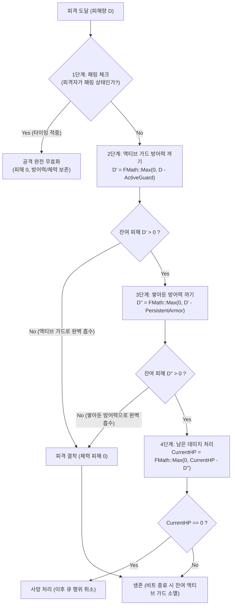

# [BBM GDD] 03. 1D 전투 규칙 · 방어 체계 · 상태이상 (Combat Mechanics)

> **상위 기획 규칙**: [game-design-guide.md](file:///e:/Unreal/P_AI_Inven/DIS/.agents/rules/game-design-guide.md)  
> **주요 역할**: 1D 레인 진형, 타깃 범위, 3단계 방어 체계, 스태킹 상태이상 계산 공식 단일 진실 공급원 (턴 루프/페이즈 규칙은 [04_Turn_Lifecycle_and_States.md](file:///e:/Unreal/P_AI_Inven/DIS/Docs/GDD/04_Turn_Lifecycle_and_States.md) 참조)

---

## 1. 1D 레인 진형 및 대칭 구조 (Line Formation System)
- **진영(Faction)**: 아군 레인(`AllyLane`), 적군 레인(`EnemyLane`).
- **1D 인덱스 규칙**:
  - `Index 0`: **최전방(Frontline)** — 기본 단일 타격의 1순위 피격 대상.
  - `Index 1 ~ N-1`: **후방 라인(Backline)** — 전방 유닛의 보호를 받음.
  - 플레이어 측도 소환수/동료 추가 시 `[소환수, 플레이어]` 순으로 배치되어 소환수가 최전방에서 대신 맞을 수 있는 대칭 구조.

---

## 2. 타깃 적용 범위 (`EBBMTargetScope`)
| 적용 범위 (Enum) | 대상 유닛 | 주요 활용처 |
| :--- | :--- | :--- |
| **`EnemyFrontline`** | 상대 진영 `Index 0` (최전방 1인) | 단일 무기 공격, 단검 찌르기, 최전방 넉백/독 |
| **`EnemyAll`** | 상대 진영 생존 유닛 전원 | 대검 휘두르기(광역 베기), 화염 폭발(광역 화상) |
| **`Self`** | 행동 시전자 본인 | 자가 방어도 축적(`GainArmor`), 즉시 방어(`ActiveGuard`), 1비트 패링(`Parry`), 개인 물약 |
| **`AllAllies`** | 아군 진영 생존 유닛 전원 (플레이어 + 소환수) | 아군 전체 지휘 버프, 배낭 향로(지속 힐), 전체 방어막 전개 |
| **`AllyFrontline`** | 아군 진영 `Index 0` (전방 소환수/탱커) | 전방 탱커 집중 힐/방어도 지원, 방패 넘겨주기 |

---

## 3. 3단계 방어 체계 (Armor vs Guard vs Parry)
방어력 시스템은 **누적 형식**이며, 모든 피해는 **체력 차감 전에 방어력이 먼저 소모**됨.

1. **지속 방어도 축적 / 장비 (`GainArmor`)**: 턴과 무관하게 누적 유지되며 피격 소진 전까지 보존되는 방어력.
2. **순간 방어 / 가드 (`ActiveGuard`)**: 해당 비트 타이밍에만 `N`만큼 일시 상승했다가 해당 비트 종료 시 잔여분이 자동 소멸하는 방어력.
3. **패링 (`Parry`)**: 매개변수 없는 타이밍 판정 전용. 공격 비트와 일치 시 피해를 `0`으로 완전 무효화(방어력·체력 손실 없음).
4. **엄격한 4단계 피해 처리 순서**:
   $$\text{[1. 패링 체크]} \longrightarrow \text{[2. 액티브 가드 방어력 까기]} \longrightarrow \text{[3. 쌓아둔 방어력 까기]} \longrightarrow \text{[4. 남은 데미지 처리]}$$

---

## 4. 2종 스태킹 상태이상 (Stacking Status System)
상태이상은 **턴(8비트 주기) 종료 시점**에 틱(Tick)이 발동하며, 발동 직후 **스택이 1씩 감소**함 (`Stacks = FMath::Max(0, Stacks - 1)`).

1. **독 (Poison) — 초반 폭발형 누적 데미지**:
   - **피해량 공식**: $\text{Damage} = \text{CurrentStacks}$
   - 예: 3스택 → 1턴 종료 3피해(스택 2) → 2턴 종료 2피해(스택 1) → 3턴 종료 1피해(스택 0). 총 6 피해.
2. **화상 (Burn) — 균등 지속형 도트 데미지**:
   - **피해량 공식**: $\text{Damage} = \text{BaseDamage}$ (고정 피해량), 스택은 잔여 지속 턴 수 역할.
   - 예: 고정 5 피해, 3스택 → 1턴: 5 → 2턴: 5 → 3턴: 5. 총 15 피해.
