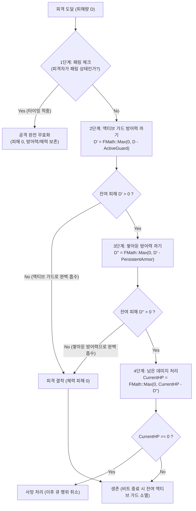

# [BBM GDD] 03. 1D 라인 전투, 리듬 행동 및 라이프사이클 (Combat & Lifecycle)

> **상위 마스터 문서**: [RhythmRoguelike_GDD.md](file:///e:/Unreal/P_AI_Inven/DIS/Docs/RhythmRoguelike_GDD.md)  
> **문서 버전**: 1.3.0 | **최종 수정일**: 2026-10-29  
> **주요 역할**: 1D 레인 진형, 타깃 범위, 3단계 방어 체계, 2종 상태이상, 6대 실행 페이즈, 4분할 연출 윈도우, 8초 턴/전투 상태 머신 단일 진실 공급원

---

## 5. 1D 라인 전투 및 리듬 행동(Beat Action) 프레임워크

### 5.1 1D 레인 진형 및 대칭 구조 (Line Formation System)
- **진영(Faction)**: 아군 레인(`AllyLane`), 적군 레인(`EnemyLane`).
- **1D 인덱스 규칙**:
  - `Index 0`: **최전방(Frontline)** — 기본 단일 타격의 1순위 피격 대상.
  - `Index 1 ~ N-1`: **후방 라인(Backline)** — 전방 유닛의 보호를 받음.
  - 플레이어 측도 소환수/동료가 추가되면 `[소환수, 플레이어]` 순으로 배치되어 소환수가 최전방에서 대신 맞을 수 있는 대칭 구조.

---

### 5.2 타깃 적용 범위 (`EBBMTargetScope`)
| 적용 범위 (Enum) | 대상 유닛 | 주요 활용처 |
| :--- | :--- | :--- |
| **`EnemyFrontline`** | 상대 진영 `Index 0` (최전방 1인) | 단일 무기 공격, 단검 찌르기, 최전방 넉백/독 |
| **`EnemyAll`** | 상대 진영 생존 유닛 전원 | 대검 휘두르기(광역 베기), 화염 폭발(광역 화상) |
| **`Self`** | 행동 시전자 본인 | 자가 방어도 축적(`GainArmor`), 즉시 방어(`ActiveGuard`), 1비트 패링(`Parry`), 개인 물약 |
| **`AllAllies`** | 아군 진영 생존 유닛 전원 (플레이어 + 소환수) | 아군 전체 지휘 버프, 배낭 향로(지속 힐), 전체 방어막 전개 |
| **`AllyFrontline`** | 아군 진영 `Index 0` (전방 소환수/탱커) | 전방 탱커 집중 힐/방어도 지원, 방패 넘겨주기 |

---

### 5.3 3단계 방어 체계 (Armor vs Guard vs Parry)
방어력 시스템은 **누적 형식**이며, 모든 피해는 **체력에 들어가기 전에 방어력이 먼저 까임**.



1. **지속 방어도 축적 / 장비 (`GainArmor`)**:
   - **매개변수**: `Amount` (N)
   - **동작**: **턴 관계없이 계속 쌓아두는 누적 방어력**. 공격을 받아 소진되기 전까지는 턴이 지나도 사라지지 않고 계속 유지됨.
2. **순간 방어 / 가드 (`ActiveGuard`)**:
   - **매개변수**: `Amount` (N)
   - **동작**: **해당 비트 순간 타이밍에만 방어력이 N만큼 일시적으로 올랐다가, 해당 비트 종료 시 소멸하는 순간 방어력**. 적의 공격 비트에 맞춰 가드를 올리면 그 타이밍에만 방어력이 급증하여 피해를 흡수함.
3. **패링 (`Parry`)**:
   - **매개변수**: **없음** (타이밍 판정 전용)
   - **동작**: 공격 타이밍과 패링 비트가 일치하면 **공격을 아예 무효화 (0 피해)**. 방어력도 전혀 까지지 않음.
4. **엄격한 4단계 피해 처리 순서 (Step-by-Step Resolution)**:
   $$\text{[1. 패링 체크]} \longrightarrow \text{[2. 액티브 가드 방어력 까기]} \longrightarrow \text{[3. 쌓아둔 방어력 까기]} \longrightarrow \text{[4. 남은 데미지 처리]}$$
   - **1단계 (패링 체크)**: 패링 상태면 피해량 0으로 즉시 종료 (방어력/체력 100% 보존).
   - **2단계 (액티브 가드 방어력 까기)**: 순간 방어력(`ActiveGuard`)을 먼저 소진하여 1차 흡수.
   - **3단계 (쌓아둔 방어력 까기)**: 액티브 가드로 다 막지 못한 잔여 피해를 지속 방어력(`GainArmor`)에서 2차 차감.
   - **4단계 (남은 데미지 처리)**: 모든 방어력을 뚫고 남은 최종 피해만 체력(`CurrentHP`)에 차감 적용.
   - 비트 종료 시: 해당 비트에 다 쓰지 않고 남은 `ActiveGuard` 순간 방어력은 자동으로 증발(소멸).

---

### 5.4 2종 스태킹 상태이상 (Stacking Status System)
상태이상은 **턴(8비트 주기) 종료 시점**에 틱(Tick)이 발동하며, 발동 직후 **스택이 1씩 감소**함 (`Stacks = FMath::Max(0, Stacks - 1)`).

1. **독 (Poison) — 초반 폭발형 누적 데미지**:
   - **피해량 공식**: $\text{Damage} = \text{CurrentStacks}$
   - 예: 3스택 $\rightarrow$ 1턴 종료 3피해(스택 2) $\rightarrow$ 2턴 종료 2피해(스택 1) $\rightarrow$ 3턴 종료 1피해(스택 0). 총 6 피해.
2. **화상 (Burn) — 균등 지속형 도트 데미지**:
   - **피해량 공식**: $\text{Damage} = \text{BaseDamage}$ (고정 피해량)
   - 스택은 **잔여 지속 턴 수** 역할을 함.
   - 예: 고정 5 피해, 3스택 $\rightarrow$ 1턴: 5 $\rightarrow$ 2턴: 5 $\rightarrow$ 3턴: 5. 총 15 피해.

---

### 5.5 6대 논리 실행 범주 (6-Phase Logical Pipeline)
동일 비트 내에서 효과 간의 실행 순서는 아래의 6단계를 엄격히 준수함:

$$\text{[1. 선 Movement]} \rightarrow \text{[2. 선 버프/디버프]} \rightarrow \text{[3. 방어]} \rightarrow \text{[4. 데미지]} \rightarrow \text{[5. 후 버프/디버프]} \rightarrow \text{[6. 후 Movement]}$$

- **1단계: 선 Movement (`PreMovement`)**: 타격 전 자리 이동 (아군 자리 교체, 적 끌어오기 등 진형 확정).
- **2단계: 선 버프/디버프 (`PreBuffDebuff`)**: 타격 전 공격력 증가, 취약/약화 징표 부여.
- **3단계: 방어 (`Defense`)**: `Parry`, `ActiveGuard`, `GainArmor` 발동.
- **4단계: 데미지 (`Damage`)**: 패링(0 피해) $\rightarrow$ 가드(방어도 차감) $\rightarrow$ 잔여 체력 피해 결착.
- **5단계: 후 버프/디버프 (`PostBuffDebuff`)**: 타격 후 `ApplyStatus`(독/화상) 스택 부여, 흡혈.
- **6단계: 후 Movement (`PostMovement`)**: 타격 후 넉백(적 밀쳐내기), 반동으로 인한 후퇴.

---

### 5.6 4분할 애니메이션 연출 윈도우 (4-Slot Visual Timeline)
1비트(120 BPM 기준 500ms)를 6개로 나누지 않고, **4개의 연출 윈도우(각 125ms)**로 묶어 애니메이션 블렌딩과 시인성을 확보함.

```
+-----------------------------------------------------------------------------------+
|  Window 1 (0~125ms)    : [1. 선 Movement] 진형 이동 / 대시 모션                     |
|  Window 2 (125~250ms)  : [2. 선 버프/디버프 + 3. 방어] 차징 / 가드·패링 모션        |
|  Window 3 (250~375ms)  : [4. 데미지 + 5. 후 버프/디버프] 타격 임팩트 / 독·화상 발동  |
|  Window 4 (375~500ms)  : [6. 후 Movement] 넉백 / 후퇴 리액션                       |
+-----------------------------------------------------------------------------------+
```

---

## 6. 전투 라이프사이클 프레임워크 (Battle Lifecycle)

```mermaid
stateDiagram-v2
    [*] --> Preparation : 전투 진입

    state Preparation {
        [*] --> TimerRunning : 8초 실시간 타이머 시작
        TimerRunning --> DragReorder : 사용자 배낭 인벤토리 실시간 재배치
        DragReorder --> TimerRunning
        TimerRunning --> TimeExpired : 8초 경과 (타이머 종료)
        TimeExpired --> BuildQueues : 인벤토리 위치 확정<br>8개 비트별 6대 큐 빌드 (주인공 -> 적군 순)
    }

    Preparation --> Simulation : 큐 빌드 완료

    state Simulation {
        [*] --> BeatLoop : 1비트 시작
        state BeatLoop {
            [*] --> ExecPreMove : 1. 선 Movement 큐
            ExecPreMove --> ExecPreBuff : 2. 선 버프/디버프 큐
            ExecPreBuff --> ExecDefense : 3. 방어 큐 (패링/가드)
            ExecDefense --> ExecDamage : 4. 데미지 큐
            ExecDamage --> CheckDeath : 4-1. 사망 체크 & 유령 행위 취소
            CheckDeath --> ExecPostBuff : 5. 후 버프/디버프 큐
            ExecPostBuff --> ExecPostMove : 6. 후 Movement 큐
            ExecPostMove --> CheckMatchOver : 7. 승리/패배 체크 (승패 시 남은 비트 싹 비움)
        }
        BeatLoop --> BeatLoop : 다음 비트 진행 (2~8비트)
        BeatLoop --> EndOfBeats : 8비트 완료
    }

    Simulation --> TurnResolution : 8비트 종료

    state TurnResolution {
        [*] --> StatusTick : 8. 상태이상 발동 (독/화상) & 스택 1 차감
        StatusTick --> PostStatusDeathCheck : 9. 사망 상태 체크
        PostStatusDeathCheck --> PostStatusMatchCheck : 10. 승리/패배 체크
        PostStatusMatchCheck --> ArchiveUsedEquipment : 11. 이번 턴 사용된 장비(OncePerBattle) 배낭 해제 및 별도 보관 칸 이관
        ArchiveUsedEquipment --> GenerateIntents : 12. 적군 다음 턴 인텐트 생성 & 프리뷰 갱신
    }

    TurnResolution --> Preparation : 승패 미결정 시 다음 턴 반복
    TurnResolution --> BattleEnd : 승리 또는 패배 확정 (종료 시 보관 장비 복원)
    BattleEnd --> [*]
```



### 6.1 핵심 라이프사이클 규칙
1. **턴 준비 (8초)**:
   - 8초 실시간 타이머 동안 인벤토리 자유 편집 및 프리뷰 실시간 동기화.
   - 시간 초과 즉시 마우스 드래그 중인 아이템을 직전 유효 슬롯으로 **강제 스냅 롤백** 후 인벤토리 잠금.
2. **책임 분리 및 큐 빌드**:
   - 캐릭터는 비트별 발생 효과(`TArray<FBBMActionEffect>`)만 들고 있음.
   - 전투 시뮬레이터(`UBBMCombatSimulator`)가 비트별 × 6대 범주 큐로 자동 분배 및 보관.
   - 동일 비트 동일 큐 내에서는 **주인공(좌측) $\rightarrow$ 적군(우측)** 순서로 정렬.
3. **사망자 행위 차단 (No Ghost Actions)**:
   - 4단계(데미지) 직후 사망 판정. 사망한 액터가 뒤에 남겨둔 행위는 큐 순회 시 즉시 스킵(`continue`).
4. **동시 사망 = 패배 (Rule 1)**:
   - 플레이어와 적이 동일 비트 또는 상태이상 틱으로 동시에 사망하면 **패배(Defeat)**로 판정.
5. **조기 전투 종료 시 전량 플러시 (Rule 3)**:
   - 승리 또는 패배가 확정되면 남아있는 모든 비트의 큐를 **즉시 싹 비우고(Flush/Reset)** 시뮬레이션을 조기 종료.
6. **아이템 프로파일별 사후 처리 (Item Post-Use Resolution)**:
   - **무기(`Unlimited`)**: 발동 후에도 배낭 칸 위치를 그대로 유지하며 다음 턴에도 즉시 재사용 가능.
   - **장비(`OncePerBattle`)**: 이번 턴 타임라인에서 실행 완료된 장비는 턴 종료(`TurnResolution`) 시점에 중앙 배낭 인벤토리에서 비가시 별도 보관 인벤토리(`UsedEquipmentStorage`)로 소유권이 이관됨. 이로써 **다음 턴부터 배낭 칸을 전혀 차지하지 않고 화면에서도 숨겨지며**, 빈자리에 다른 무기·소모품을 재배치할 수 있음.
   - **소모품(`ConsumeOnUse`)**: 효과 발동 직후 `PopEntry()`로 수량을 1 차감하며, 스택이 비워지면(`IsEmpty() == true`) 즉시 배낭 슬롯에서 제거(`ClearItemStack`)되어 영구 소멸함.

