# [BBM GDD] 04. 테크니컬 아키텍처 및 로드맵 (Architecture & Roadmap)

> **상위 마스터 문서**: [RhythmRoguelike_GDD.md](file:///e:/Unreal/P_AI_Inven/DIS/Docs/RhythmRoguelike_GDD.md)  
> **문서 버전**: 1.3.0 | **최종 수정일**: 2026-10-29  
> **주요 역할**: C++ 클래스 다이어그램, 모듈 간 의존성, GAS 연동 인터페이스, 단계별 개발 로드맵/마일스톤 진행 현황 단일 진실 공급원

---

## 7. 테크니컬 아키텍처 및 C++ 클래스 설계 (`Source/DIS`)

```mermaid
classDiagram
    class ABBMGameModeBase {
        +EBBMBattlePhase CurrentPhase
        +float PrepTimerRemaining
        +StartBattlePrep()
        +StartSimulation()
    }
    class UBBMCombatSimulator {
        -FBBMSimulationBeatQueues TimelineBeats[8]
        +BuildQueuesFromCombatants()
        +SimulateBeat(int32 BeatIndex)
        +FlushRemainingBeats()
        +CheckBattleResult() EBBMBattleResult
    }
    class UBBMGlobalDefinition {
        +TMap~FGameplayTag, FDISItemTypeProfile~ ItemTypeProfiles
        +TMap~FGameplayTag, FBBMItemGroupProfile~ ItemGroupProfiles
    }
    class UBBMGlobalLogic {
        +GetItemUsageRule(FGameplayTag) EBBMItemUsageRule
        +GetItemGroupProfile(FGameplayTag) FBBMItemGroupProfile
    }
    class FBBMItemTypeCustomData {
        +int32 MaxStackCount
        +EBBMItemUsageRule UsageRule
    }
    class UBBMItemDefinition {
        +int32 Price
        +TArray~FBBMBeatDefinition~ Beats
        +TArray~TSoftClassPtr~UAnimInstance~~ LinkedAnimLayers
        +TArray~FBBMItemGameplayEffectConfig~ DefaultGrantedEffects
        +FGameplayTagContainer ItemGroupTags
        +GetBeatCount() int32
        +HasItemGroup(Tag) bool
    }
    class UBBMItemEntry {
        +TArray~FBBMBeatDefinition~ DynamicBeats
        +TArray~FBBMItemGameplayEffectConfig~ DynamicGrantedEffects
        +AddEffectToBeat(BeatIndex, EffectClass) bool
        +AddDynamicBeat(Beat) void
        +SetByCallerMagnitude(Tag, Value) bool
        +GetSetByCallerMagnitude(Tag) float
    }
    class FBBMItemGameplayEffectConfig {
        +TSoftClassPtr~UGameplayEffect~ EffectClass
        +TMap~FGameplayTag, float~ SetByCallerMagnitudes
    }
    class UBBMAttributeSet {
        +FGameplayAttributeData Health
        +FGameplayAttributeData MaxHealth
        +FGameplayAttributeData Armor
        +FGameplayAttributeData AttackPower
        +FGameplayAttributeData DefensePower
    }
    class FBBMBeatAction {
        +EBBMActionCategory ActionCategory
        +GetActionCategory() EBBMActionCategory
    }
    class FBBMCombatAction {
        +EBBMActionCategory ActionCategory
        +EBBMTargetScope TargetScope
        +float Coefficient
        +float BaseValue
        +CalculateMagnitude(InAttributeValue) float
    }
    class FBBMMovementAction {
        +EBBMActionCategory ActionCategory
        +int32 StepCount
    }
    class FBBMBeatAnimationConfig {
        +EBBMVisualWindow VisualWindow
        +FGameplayTag StateTag
        +IsValid() bool
    }
    class FBBMBeatDefinition {
        +TArray~TInstancedStruct~FBBMBeatAction~~ Actions
        +TArray~FBBMBeatAnimationConfig~ Animations
        +HasActions() bool
        +HasAnimations() bool
    }
    class ABBMCombatantBase {
        +UAbilitySystemComponent AbilitySystemComponent
        +UBBMAttributeSet AttributeSet
        +TSoftObjectPtr~UCurveTable~ InitialStatsCurveTable
        +FName CharacterGroupName
        +int32 CharacterLevel
        +int32 LaneIndex
        +bool bIsAlly
        +InitializeStats() void
        +InitializeStatsWithCurveTable(CurveTable, GroupName, Level) void
        +GetHealth() float
        +GetMaxHealth() float
        +GetArmor() float
        +GetAttackPower() float
        +GetDefensePower() float
        +IsDead() bool
    }
    class UBBMCombatSimulator {
        +ApplyItemGrantedEffects(Combatant, ItemEntry, OutHandles) bool$
        +RemoveItemGrantedEffects(Combatant, Handles) void$
        +ResolveDamage(Combatant, Damage, bParrying, ActiveGuard) float$
        +ResolveGainArmor(Combatant, ArmorAmount) void$
    }

    ABBMGameModeBase --> UBBMCombatSimulator : 제어
    UBBMCombatSimulator --> ABBMCombatantBase : 큐 분배 및 교전 해결
    UBBMCombatSimulator ..> UBBMItemEntry : 비트 시작 시 GE 적용 / 비트 종료 시 GE 해제
    UBBMGlobalDefinition --|> UDISGlobalDefinition : 3대 프로파일/그룹 정의
    UBBMGlobalLogic --|> UDISGlobalLogic : 사용 규칙 및 그룹 해석
    FBBMItemTypeCustomData --|> FDISItemTypeCustomData : 스택 한도 및 사용 규칙 확장
    UBBMItemDefinition --|> UDISItemDefinition : 그룹/비트/애님/기본GE 확장
    UBBMItemEntry --|> UDISItemEntry : 런타임 비트/동적GE 소유 및 강화
    UBBMItemDefinition ..> UBBMItemEntry : 인스턴스화 시 정적 템플릿 복사
    UBBMItemDefinition --> FBBMBeatDefinition : 비트 시퀀스 보유
    UBBMItemDefinition --> FBBMItemGameplayEffectConfig : 기본 GAS Effect 보유
    FBBMBeatDefinition --> FBBMBeatAction : 다형성 액션 목록 소유
    FBBMBeatDefinition --> FBBMBeatAnimationConfig : 윈도우별 연출 보유
    ABBMCombatantBase --> UBBMAttributeSet : GAS 스탯 관리
```



### 7.1 C++ 핵심 미구현 타입 정의
```cpp
/* 단일 비트의 6대 큐 컨테이너 */
USTRUCT(BlueprintType)
struct FBBMSimulationBeatQueues
{
	GENERATED_BODY()

	UPROPERTY(BlueprintReadOnly, Category = "Battle")
	TArray<FBBMQueuedEffect> PhaseQueues[6];

	TArray<FBBMQueuedEffect>& GetQueue(EBBMActionCategory Category)
	{
		return PhaseQueues[static_cast<uint8>(Category)];
	}

	void Reset()
	{
		for (int32 Index = 0; Index < 6; ++Index)
		{
			PhaseQueues[Index].Reset();
		}
	}
};
```

---

## 8. 단계별 개발 로드맵 (Roadmap)

### 기반 마일스톤: 아이템 프로파일 아키텍처 및 사후 보관 데이터 규격
- [x] DIS `UDISItemDefinition::MaxDurability` 기본값 `0.0f`(내구도 무제한) 전환 및 `FDISItemTypeProfile::bOverrideCustomData` 선택적 상속 구조 구현.
- [x] BBM 3대 아이템 프로파일(`Weapon` 6종 — 방패 포함, `Equipment` 4종 — 전투당 1회 사용 후 별도 칸 보관, `Consumable` 3종 — 기본 5스택 및 사용 후 소멸) 네이티브 태그 및 `FBBMItemTypeCustomData` 구현.
- [x] BBM 아이템 비트 시퀀스(점유 칸 수와 동일한 Beats 배열 및 IsDataValid 검증), 링크드 애님 레이어(`LinkedAnimLayers`), 상품 가격(`Price`), TInstancedStruct 기반 `FBBMBeatAction` 및 4대 윈도우 애니메이션 구성(`FBBMBeatAnimationConfig`) 구현.
- [x] 단위 테스트: 프로파일 계층 상속/Override 검증, 장비 별도 보관 칸 이관 및 소모품 5스택 소진 검증, 비트 수/타일 점유 수 일치 및 애님 레이어 유효성 검증.

### GAS 캐릭터 스탯 및 교전 해결기 마일스톤
- [x] GAS 플러그인 의존성 활성화 및 BBM 5대 핵심 어트리뷰트(`Health`, `MaxHealth`, `Armor`, `AttackPower`, `DefensePower`) `UBBMAttributeSet` 구현.
- [x] `UBBMItemEntry` 런타임 가변 비트(`DynamicBeats`) 및 동적 Granted GE(`DynamicGrantedEffects`) 소유 및 강화 인터페이스 구현.
- [x] `ABBMCombatantBase` 전투원 액터에 ASC 및 AttributeSet 장착, `CompositeCurveTable` / `UCurveTable` 기반 레벨별 스탯 주입 파이프라인(`FAttributeSetInitterDiscreteLevels`) 구현.
- [x] `UBBMCombatSimulator` 비트 단위 아이템 GE 부여/해제 및 GDD 5.3 엄격한 4단계 피해 해결기(`ResolveDamage`, `ResolveGainArmor`) 구현.
- [x] 단위 테스트: `DIS.BBM.Combat.*` 3종 테스트 추가 (CompositeCurveTable 스탯 초기화, 비트 아이템 GE 라이프사이클 원복, 4단계 교전 피해 해결 파이프라인 100% 통과).

### 마일스톤 1: 1D 전투 데이터 모델 및 비트 큐 분배기
- [ ] `EBBMTargetScope`, `EBBMActionCategory`, `FBBMActionEffect`, `FBBMSimulationBeatQueues` 구조체 구현.
- [ ] `UBBMCombatSimulator` 큐 분배기 구현 (캐릭터 미분류 데이터 $\rightarrow$ 6대 큐 분배 및 주인공-적 정렬).
- [ ] 단위 테스트: 6대 큐 정렬 검증, 사망자 큐 스킵 검증, 조기 종료 플러시 검증.

### 마일스톤 2: 턴 라이프사이클 및 8초 준비 상태 머신
- [ ] `ABBMGameModeBase` 8초 타이머 및 턴 루프 구현.
- [ ] 준비 단계 8초 만료 시 드래그 강제 스냅 롤백 연동.
- [ ] 하단 듀얼 프리뷰 위젯과의 실시간 동기화.

### 마일스톤 3: 8비트 전투 시뮬레이션 및 교전 해결기
- [ ] 6대 페이즈 순차 실행기 (이동 $\rightarrow$ 선버프 $\rightarrow$ 방어 $\rightarrow$ 데미지 $\rightarrow$ 후버프 $\rightarrow$ 후이동).
- [ ] 패링(0 피해) / 가드(방어도 차감) / 직격 판정기.
- [ ] 턴 종료 독/화상 상태이상 틱 및 스택 차감기.

### 마일스톤 4: 4분할 비주얼 연출 및 오디오 동기화
- [ ] 1비트 4등분(각 125ms) 서브비트 윈도우 기반 애니메이션 디스패처.
- [ ] 상단 4-Tile 리듬 트랙 점등 및 120 BPM 메트로놈 사운드 연동.

