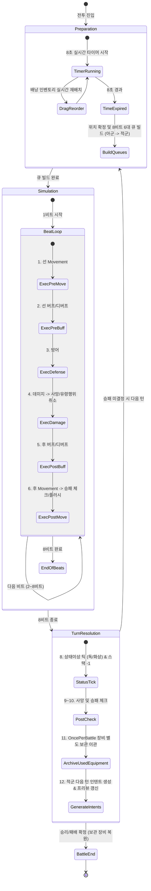

# [BBM GDD] 04. 실행 페이즈 · 연출 윈도우 · 턴 라이프사이클 (Turn Lifecycle)

> **상위 기획 규칙**: [game-design-guide.md](file:///e:/Unreal/P_AI_Inven/DIS/.agents/rules/game-design-guide.md)  
> **주요 역할**: 비트 내 6대 실행 페이즈, 4분할 애니메이션 윈도우, 8초 준비 → 시뮬레이션 → 턴 해결 상태 머신 단일 진실 공급원

---

## 1. 6대 논리 실행 범주 (6-Phase Logical Pipeline)
동일 비트 내에서 효과 간의 실행 순서는 아래 6단계를 엄격히 준수함:

$$\text{[1. 선 Movement]} \rightarrow \text{[2. 선 버프/디버프]} \rightarrow \text{[3. 방어]} \rightarrow \text{[4. 데미지]} \rightarrow \text{[5. 후 버프/디버프]} \rightarrow \text{[6. 후 Movement]}$$

1. **선 Movement (`PreMovement`)**: 타격 전 자리 이동 (아군 교체, 적 끌어오기 등 진형 확정)
2. **선 버프/디버프 (`PreBuffDebuff`)**: 타격 전 공격력 증가, 취약/약화 징표 부여
3. **방어 (`Defense`)**: `Parry`, `ActiveGuard`, `GainArmor` 발동
4. **데미지 (`Damage`)**: 패링(0 피해) → 가드/방어도 차감 → 잔여 체력 피해 결착
5. **후 버프/디버프 (`PostBuffDebuff`)**: 타격 후 `ApplyStatus`(독/화상) 스택 부여, 흡혈
6. **후 Movement (`PostMovement`)**: 타격 후 넉백(적 밀쳐내기), 반동 후퇴

---

## 2. 4분할 애니메이션 연출 윈도우 (4-Slot Visual Timeline)
1비트(120 BPM 기준 500ms)를 6개로 쪼개지 않고 **4개의 연출 윈도우(각 125ms)**로 묶어 애니메이션 블렌딩과 시인성을 확보함.

```text
+-----------------------------------------------------------------------------------+
|  Window 1 (0~125ms)    : [1. 선 Movement] 진형 이동 / 대시 모션                     |
|  Window 2 (125~250ms)  : [2. 선 버프/디버프 + 3. 방어] 차징 / 가드·패링 모션        |
|  Window 3 (250~375ms)  : [4. 데미지 + 5. 후 버프/디버프] 타격 임팩트 / 독·화상 발동  |
|  Window 4 (375~500ms)  : [6. 후 Movement] 넉백 / 후퇴 리액션                       |
+-----------------------------------------------------------------------------------+
```

---

## 3. 전투 라이프사이클 프레임워크 (Battle Lifecycle)



### 3.1 핵심 라이프사이클 규칙
1. **턴 준비 (8초)**: 실시간 자유 편집 및 프리뷰 동기화. 시간 초과 시 드래그 중인 아이템을 직전 유효 슬롯으로 **강제 스냅 롤백** 후 잠금.
2. **책임 분리 및 큐 정렬**: 캐릭터는 비트별 효과만 보유하고 전투 시뮬레이터가 비트별×6대 큐로 분배. 동일 비트 동일 큐 내에서는 **주인공(좌측) → 적군(우측)** 순서 정렬.
3. **사망자 행위 차단 (`No Ghost Actions`)**: 데미지 단계 직후 사망 판정 시, 사망 액터의 후속 큐 행위는 순회 중 즉시 스킵(`continue`).
4. **동시 사망 = 패배 / 조기 종료 시 전량 플러시**: 동시 사망 시 패배 판정, 승패 확정 시 남아있는 모든 비트 큐를 즉시 플러시하고 시뮬레이션 조기 종료.
5. **아이템 프로파일별 사후 처리**: 무기(`Unlimited`)는 위치 유지, 장비(`OncePerBattle`)는 `TurnResolution`에 `UsedEquipmentStorage`로 이관(전투 종료 시 복원), 소모품(`ConsumeOnUse`)은 발동 즉시 스택 -1 및 `0`이 되면 영구 소멸.
