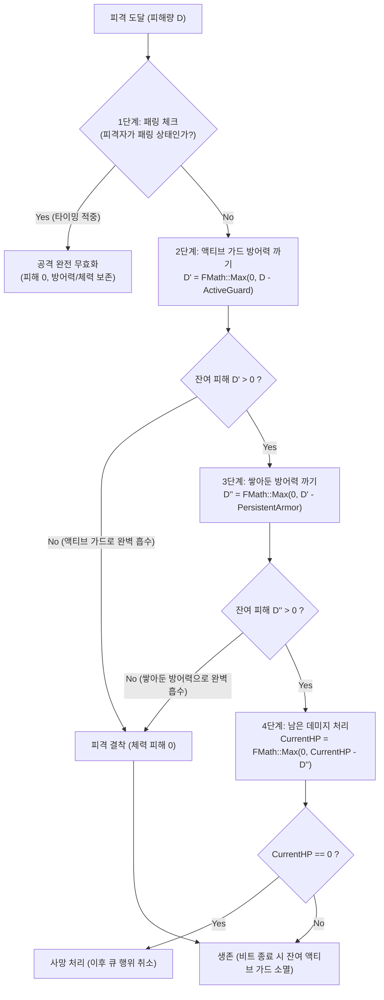
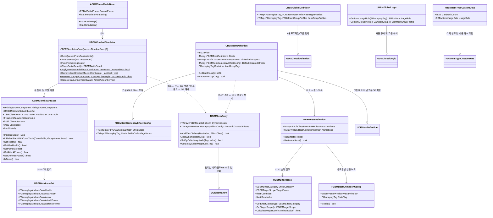

# [GDD] 비트 배낭 상인 (Beat Backpack Merchant)
## 리듬 액션 × 그리드 인벤토리 × 로그라이크 게임 기획서 & 테크니컬 디자인 규격서

- **문서 버전**: 1.3.0
- **최종 수정일**: 2026-10-29
- **상태**: 3대 아이템 프로파일(무기·장비·소모품) 및 사후 보관/소모 규격, 1D 라인 전투, 6대 액션 범주 & 4분할 비주얼 타임라인, 8초 턴 라이프사이클 확정 (BBM 표준)
- **장르**: 리듬 액션 타임라인 + 인벤토리 퍼즐 + 턴제 로그라이크
- **엔진 버전**: Unreal Engine 5.8.3 (C++ 20)
- **기반 플러그인**: DIS (Data-Driven Inventory System) — 호스트 게임 비종속 범용 데이터 드리븐 구조 유지

---

## 1. 게임 개요 및 핵심 콘셉트

### 1.1 콘셉트 (The Narrative Concept)
모험가들에게 물건을 팔기 위해 위험천만한 던전으로 모험을 떠난 떠돌이 상인!
하지만 던전 깊숙한 곳에서 모험가는 온데간데없고 흉악한 몬스터와 보스들이 상인을 가로막는다.
상인은 살기 위해, 그리고 팔다 남은 재고를 털어내기 위해 가방 속의 무기와 방어구들을 찰나의 순간에 꺼내 들고 신명 나는 리듬에 맞춰 휘두르기 시작한다!

### 1.2 핵심 게임플레이 필라 (Core Pillars)
1. **인벤토리 공간 최적화 (Grid Spatial Puzzle)**:
   - DIS 플러그인의 2D 그리드 인벤토리를 기반으로 크기와 형상이 다양한 아이템들을 제한된 가방 칸에 맞추어 테트리스처럼 배치.
2. **초단기 실시간 판단 (8-Second Real-time Prep)**:
   - 몬스터와 조우하면 **8초의 준비 카운트다운** 동안 아이템을 신속하게 드래그·재배치하여 전투 시퀀스를 즉각 재구성.
3. **점유 칸 수 비례 8비트 타임라인 (Cell-Count Proportional Beats)**:
   - **아이템이 점유하는 칸 수(Occupied Cell Count) = 행동에 필요한 비트 소비량**.
   - 가방의 좌상단부터 우하단 순서대로 8비트 길이의 타임라인에 차례대로 배치 및 누적.
4. **예측과 능동적 카운터 (Monster Intent & Dual Preview)**:
   - 하단 우측의 몬스터 행동 예고를 파악하고, 하단 좌측의 주인공 프리뷰를 실시간으로 맞대응하여 방패 가드 및 폭딜 콤보 구성.
5. **로그라이크 빌드 성장 (Roguelike Progression)**:
   - 전투 승리 보상, 가방 용량 확장(`ExpandCapacity`), 강화 젬 장착을 통한 매 판 새로운 빌드 완성.

---

## 2. 아트 디렉션 및 비주얼 가이드라인

```
+-----------------------------------------------------------------------------------+
| 아트 키워드: [동화풍 판타지] × [보부상의 가죽 가방] × [양피지 & 황동 기어 메커니즘]   |
+-----------------------------------------------------------------------------------+
```

### 2.1 시각적 분위기 (Mood & World)
- **분위기**: 밝고 유쾌하며 따뜻한 동화풍 판타지 (밝은 초원, 고성, 맑은 강, 유쾌한 몬스터).
- **주인공 캐릭터**: 몸집만 한 커다란 가죽 배낭과 각종 장비를 짊어지고 지팡이를 짚은 개성 만점의 꼬마 보부상.
- **몬스터 캐릭터**: 위협적이면서도 코믹하고 개성 있는 디자인 (오크 전사, 고블린 궁수, 푸른 슬라임 등).

### 2.2 UI 재질 및 테마 (Material & Style)
- **질감 및 텍스처**:
  - 가죽 가방 (따뜻한 갈색 가죽 스티치)
  - 원목 프레임 (묵직하고 엔틱한 나무 테두리)
  - 황동 장식 (리벳, 버클, 톱니바퀴 메탈 포인트)
  - 양피지 (타임라인 및 행동 프리뷰 배경)
- **색상 코딩 체계 (Color Coding)**:
  - **공격 (Attack)**: 붉은색 계열 (칼, 발톱 아이콘)
  - **방어 (Defense)**: 청록/푸른색 계열 (방패, 가드 아이콘)
  - **소모품/회복 (Consumable)**: 자주/루비색 계열 (포션, 비약 아이콘)
  - **특수/강타 (Special/Smash)**: 보라/해골 계열 (강력한 적 패턴, 치명타)
- **핵심 시각 원칙**:
  - 배경 아트는 세계관과 몰입감을 풍부하게 전달하고,
  - 인벤토리와 타임라인 UI는 명도/채도 대비를 주어 **8초의 제한 시간 동안 플레이어가 핵심 정보를 0.1초 만에 인지**할 수 있도록 직관성을 최우선함.

---

## 3. 화면 레이아웃 및 3단 UI 아키텍처

```
+-----------------------------------------------------------------------------------+
|  [주인공: 보부상]     [타일 4]     [타일 3]     [타일 2]     [타일 1]    [적: 몬스터 무리]  |
|                      (7~8비트)    (5~6비트)    (3~4비트)    (1~2비트)                     |
|                   <====== 비트 활성화 진행 방향 (적 -> 주인공) ======                     |
+-----------------------------------------------------------------------------------+
|                                                                                   |
|                                     [ ↑ ] (무기 사용 기준 방향)                    |
|                        +-----------------------------+                            |
|                        | [대검] [대검] [단검] [방패] |                            |
|                        | [대검] [대검] [ . ]  [방패] |                            |
|                        | [ . ]  [ . ]  [ . ]  [방패] |                            |
|                        | [ . ]  [포션] [ . ]  [방패] |                            |
|                        +-----------------------------+                            |
|                            [중앙 그리드 배낭 인벤토리]                             |
|                                                                                   |
+-------------------------------------+     +---------------------------------------+
| [Hero Next Actions]  (주인공 프리뷰) |     | [Enemy Next Actions]     (적 프리뷰)  |
| [ 1 ][ 2 ][ 3 ][ 4 ][ 5 ][ 6 ][ 7 ][ 8 ] |     | [ 1 ][ 2 ][ 3 ][ 4 ][ 5 ][ 6 ][ 7 ][ 8 ]  |
| [검 ][검 ][검 ][검 ][단 ][방 ][방 ][방 ] |     | [할 ][할 ][방 ][할 ][ . ][할 ][할 ][해 ]  |
+-------------------------------------+     +---------------------------------------+
```

### 3.1 상단 — 전투 리듬 타이머 (4-Tile Rhythm Track)
- **비트 시각화 구조**:
  - 총 8비트의 전투 주기를 **2비트씩 분할한 4개의 대형 바닥 타일**로 시각화.
  - **타일 1**: 비트 1 ~ 2
  - **타일 2**: 비트 3 ~ 4
  - **타일 3**: 비트 5 ~ 6
  - **타일 4**: 비트 7 ~ 8
- **진행 방향**:
  - 비트 펄스는 **적(우측) 방향에서 주인공(좌측) 방향**으로 차례대로 밀려오며 활성화됨.
- **시각 피드백**:
  - 현재 시뮬레이션 중인 활성 타일의 라이팅과 컬러 글로우(Glow)를 강하게 발광시켜 전투 진행 시점을 직관적으로 전달.

### 3.2 중앙 — 그리드 배낭 인벤토리 (Grid Inventory)
- **가변 확장형 격자**:
  - 로그라이크 진행(보상, 상점)에 따라 DIS 플러그인의 `ExpandCapacity`를 통해 슬롯이 확장되는 2D 격자 인벤토리.
- **점유 칸 수 = 비트 소비 규칙**:
  - 무기, 방패, 소모품 등은 형상(TileShape)에 따라 여러 칸을 차지함.
  - **아이템이 점유하는 칸 수(Point Count)가 곧 행동에 필요한 비트 수**가 됨.
- **기준 방향 표시기 (`↑`)**:
  - 인벤토리 상단 중앙에 무기 사용 기준 방향을 나타내는 화살표 표식 배치.
- **실시간 드래그 재배치**:
  - 8초 준비 시간 동안 아이템을 자유롭게 드래그하여 제한된 8비트 안에 최대 효율의 공방 시퀀스를 구성.

### 3.3 하단 좌우 — 듀얼 행동 프리뷰 (Dual 8-Beat Action Preview)
- **주인공 프리뷰 (Hero Next Actions - 하단 좌측)**:
  - 1부터 8까지 번호가 매겨진 8칸 타임라인 슬롯.
  - 인벤토리의 아이템 배치 순서(위쪽 줄 -> 왼쪽 열)에 따라 계산된 행동이 실시간으로 동기화되어 표기됨.
- **적 프리뷰 (Enemy Next Actions - 하단 우측)**:
  - 1부터 8까지 번호가 매겨진 8칸 타임라인 슬롯.
  - 몬스터의 공격, 방어, 강타 등 예정된 행동 시퀀스를 투명하게 사전 공개.

---

## 4. 인벤토리, 아이템 프로파일 및 타임라인 계산 규칙

### 4.1 아이템 정렬 및 실행 순서 규격
전투 시뮬레이션에서 아이템의 실행 순서는 **인벤토리 공간 내 배치 위치**에 의해 100% 결정됨.

1. **단일 기준점: 좌상단 루트 슬롯 (Top-Left Root Slot)**:
   - 다중 타일 점유 아이템은 DIS 플러그인의 `UDISInventory::GetItemStackBaseCoord()`를 기준으로 판정.
   - **우선순위 1**: 그리드 행 좌표 `Y` 오름차순 (위쪽 줄 우선: `Y=0` -> `Y=1` -> `Y=2`...)
   - **우선순위 2**: 동일 행 내 열 좌표 `X` 오름차순 (왼쪽 칸 우선: `X=0` -> `X=1` -> `X=2`...)
2. **비트 비용 계산 (점유 면적 연동 공식)**:
   $$\text{ItemBeatCost} = \text{InItemStack}->\text{GetOccupiedPoints}().\text{Num}()$$
3. **타임라인 순차 누적 큐 (Strict Sequential Accumulation)**:
   - 정렬된 아이템들을 순회하며 비트 누적:
     - $\text{StartBeat} = \text{CurrentBeat}$
     - $\text{EndBeat} = \text{StartBeat} + \text{ItemBeatCost}$
   - 만약 $\text{EndBeat} \le 8$ 이면 타임라인 등록 확정 및 $\text{CurrentBeat} = \text{EndBeat}$.
   - 만약 $\text{EndBeat} > 8$ 이면 해당 아이템 및 이후 대기 중인 모든 아이템은 **비트 초과(Overflow/Deactivated)**로 처리되어 이번 턴에 미실행.

### 4.2 3대 아이템 프로파일 및 사후 처리 규격 (Item Type Profiles & Usage Lifecycle)
BBM의 모든 아이템은 **내구도를 사용하지 않으며(`MaxDurability = 0.0f`, 무제한)**, 역할과 전투 중 소비·보관 방식에 따라 3대 상위 프로파일과 13종 세부 프로파일로 구분됨.

| 상위 분류 (Tag) | 하위 세부 프로파일 | 내구도 (`MaxDurability`) | 기본 `MaxStackCount` | 사용 규칙 (`EBBMItemUsageRule`) | 전투 중 사후 처리 방식 |
| :--- | :--- | :---: | :---: | :---: | :--- |
| **무기 (`Item.Weapon`)** | **방패(`Shield`)**, 한손검(`OneHandSword`), 창(`Spear`), 지팡이(`Staff`), 활(`Bow`), 단검(`Dagger`) | 없음 (`0.0f`) | `1` (스태킹 불가) | `Unlimited` | 매 턴 제한 없이 반복 발동하며 중앙 그리드 배낭 칸을 계속 유지함 (**방패는 `Equipment`가 아닌 `Weapon` 프로파일 소속**) |
| **장비 (`Item.Equipment`)** | 장갑(`Gloves`), 옷(`Clothes`), 신발(`Shoes`), 바지(`Pants`) | 없음 (`0.0f`) | `1` (스태킹 불가) | `OncePerBattle` | **전투당 1회만 사용 가능**. 타임라인에서 사용된 장비는 **다음 턴부터 인벤토리 배낭 칸을 차지하지 않고 화면에 보이지 않으며**, 데이터는 별도 보관 칸(`UsedEquipmentStorage`)에 안전히 분리 보관됨 (전투 종료 시 복원) |
| **소모품 (`Item.Consumable`)** | 물약(`Potion`), 투척물(`Throwable`), 일회성 주문서(`Scroll`) | 없음 (`0.0f`) | **`5`** (스태킹 가능) | `ConsumeOnUse` | 효과 발동 직후 스택 수량 1개가 즉시 소모되며, 잔여 수량이 `0`이 되면 배낭 인벤토리에서 영구 소멸함 |

#### 프로파일 `CustomData` 계층 상속 및 Override 규칙
1. **`CustomData` 내장 스택 및 확장 규칙**:
   - DIS 플러그인의 `FDISItemTypeCustomData`가 `MaxStackCount`(기본값 `1`)를 보유하며, BBM은 이를 상속받은 `FBBMItemTypeCustomData`에 `UsageRule`(`EBBMItemUsageRule`)을 확장 정의함.
2. **`bOverrideCustomData` 기반 선택적 상속 제어**:
   - `FDISItemTypeProfile::bOverrideCustomData == true`인 프로파일(예: `Item.Weapon`, `Item.Equipment`, `Item.Consumable` 3대 대분류)은 부모 프로파일의 `CustomData`를 상속받지 않고 자기 자신의 `CustomData`를 적용함.
   - `FDISItemTypeProfile::bOverrideCustomData == false`인 하위 프로파일(예: 방패, 한손검, 옷, 물약 등 13종 기본 세부 타입)은 **자기만의 고유 `DisplayName`과 `Icon`을 가지면서 `CustomData`(`MaxStackCount`, `UsageRule`)는 상위 부모 프로파일로부터 그대로 상속**받음.
   - 특정 희귀 주문서나 예외적인 하위 타입이 독자적인 스택 한도를 가져야 할 경우에만 해당 하위 프로파일에서 `bOverrideCustomData = true`를 활성화하여 개별 오버라이드함.

---

## 5. 1D 라인 전투 및 리듬 행동(Beat Action) 프레임워크

### 5.1 1D 레인 진형 및 대칭 구조 (Line Formation System)
- **진영(Faction)**: 아군 레인(`AllyLane`), 적군 레인(`EnemyLane`).
- **1D 인덱스 규칙**:
  - `Index 0`: **최전방(Frontline)** — 기본 단일 타격의 1순위 피격 대상.
  - `Index 1 ~ N-1`: **후방 라인(Backline)** — 전방 유닛의 보호를 받음.
  - 플레이어 측도 소환수/동료가 추가되면 `[소환수, 플레이어]` 순으로 배치되어 소환수가 최전방에서 대신 맞을 수 있는 대칭 구조.

### 5.2 타깃 적용 범위 (`EBBMTargetScope`)
| 적용 범위 (Enum) | 대상 유닛 | 주요 활용처 |
| :--- | :--- | :--- |
| **`EnemyFrontline`** | 상대 진영 `Index 0` (최전방 1인) | 단일 무기 공격, 단검 찌르기, 최전방 넉백/독 |
| **`EnemyAll`** | 상대 진영 생존 유닛 전원 | 대검 휘두르기(광역 베기), 화염 폭발(광역 화상) |
| **`Self`** | 행동 시전자 본인 | 자가 방어도 축적(`GainArmor`), 즉시 방어(`ActiveGuard`), 1비트 패링(`Parry`), 개인 물약 |
| **`AllAllies`** | 아군 진영 생존 유닛 전원 (플레이어 + 소환수) | 아군 전체 지휘 버프, 배낭 향로(지속 힐), 전체 방어막 전개 |
| **`AllyFrontline`** | 아군 진영 `Index 0` (전방 소환수/탱커) | 전방 탱커 집중 힐/방어도 지원, 방패 넘겨주기 |

### 5.3 3단계 방어 체계 (Armor vs Guard vs Parry)
방어력 시스템은 **누적 형식**이며, 모든 피해는 **체력에 들어가기 전에 방어력이 먼저 까임**.



1. **지속 방어도 축적 / 장비 (`GainArmor`)**:
   - **매개변수**: `Amount` (N)
   - **동작**: **턴 관계없이 계속 쌓아두는 누적 방어력**. 공격을 받아 소진되기 전까지는 턴이 지나도 사라지지 않고 계속 유지됨.
2. **순간 방어 / 가드 (`ActiveGuard`)**:
   - **매개변수**: `Amount` (N)
   - **동작**: **해당 비트 순간 타이밍에만 방어력이 N만큼 일시적으로 올랐다가, 해당 비트 종료 시 소멸하는 순간 방어력**. 적의 공격 비트에 맞춰 가드를 올리면 그 타이밍에만 방어력이 급증하여 피해를 흡수함.
3. **패링 (`Parry`)**:
   - **매개변수**: **없음** (타이밍 판정 전용)
   - **동작**: 공격 타이밍과 패링 비트가 일치하면 **공격을 아예 무효화 (0 피해)**. 방어력도 전혀 까지지 않음.
4. **엄격한 4단계 피해 처리 순서 (Step-by-Step Resolution)**:
   $$\text{[1. 패링 체크]} \longrightarrow \text{[2. 액티브 가드 방어력 까기]} \longrightarrow \text{[3. 쌓아둔 방어력 까기]} \longrightarrow \text{[4. 남은 데미지 처리]}$$
   - **1단계 (패링 체크)**: 패링 상태면 피해량 0으로 즉시 종료 (방어력/체력 100% 보존).
   - **2단계 (액티브 가드 방어력 까기)**: 순간 방어력(`ActiveGuard`)을 먼저 소진하여 1차 흡수.
   - **3단계 (쌓아둔 방어력 까기)**: 액티브 가드로 다 막지 못한 잔여 피해를 지속 방어력(`GainArmor`)에서 2차 차감.
   - **4단계 (남은 데미지 처리)**: 모든 방어력을 뚫고 남은 최종 피해만 체력(`CurrentHP`)에 차감 적용.
   - 비트 종료 시: 해당 비트에 다 쓰지 않고 남은 `ActiveGuard` 순간 방어력은 자동으로 증발(소멸).

### 5.4 2종 스태킹 상태이상 (Stacking Status System)
상태이상은 **턴(8비트 주기) 종료 시점**에 틱(Tick)이 발동하며, 발동 직후 **스택이 1씩 감소**함 (`Stacks = FMath::Max(0, Stacks - 1)`).

1. **독 (Poison) — 초반 폭발형 누적 데미지**:
   - **피해량 공식**: $\text{Damage} = \text{CurrentStacks}$
   - 예: 3스택 $\rightarrow$ 1턴 종료 3피해(스택 2) $\rightarrow$ 2턴 종료 2피해(스택 1) $\rightarrow$ 3턴 종료 1피해(스택 0). 총 6 피해.
2. **화상 (Burn) — 균등 지속형 도트 데미지**:
   - **피해량 공식**: $\text{Damage} = \text{BaseDamage}$ (고정 피해량)
   - 스택은 **잔여 지속 턴 수** 역할을 함.
   - 예: 고정 5 피해, 3스택 $\rightarrow$ 1턴: 5 $\rightarrow$ 2턴: 5 $\rightarrow$ 3턴: 5. 총 15 피해.

### 5.5 6대 논리 실행 범주 (6-Phase Logical Pipeline)
동일 비트 내에서 효과 간의 실행 순서는 아래의 6단계를 엄격히 준수함:

$$\text{[1. 선 Movement]} \rightarrow \text{[2. 선 버프/디버프]} \rightarrow \text{[3. 방어]} \rightarrow \text{[4. 데미지]} \rightarrow \text{[5. 후 버프/디버프]} \rightarrow \text{[6. 후 Movement]}$$

- **1단계: 선 Movement (`PreMovement`)**: 타격 전 자리 이동 (아군 자리 교체, 적 끌어오기 등 진형 확정).
- **2단계: 선 버프/디버프 (`PreBuffDebuff`)**: 타격 전 공격력 증가, 취약/약화 징표 부여.
- **3단계: 방어 (`Defense`)**: `Parry`, `ActiveGuard`, `GainArmor` 발동.
- **4단계: 데미지 (`Damage`)**: 패링(0 피해) $\rightarrow$ 가드(방어도 차감) $\rightarrow$ 잔여 체력 피해 결착.
- **5단계: 후 버프/디버프 (`PostBuffDebuff`)**: 타격 후 `ApplyStatus`(독/화상) 스택 부여, 흡혈.
- **6단계: 후 Movement (`PostMovement`)**: 타격 후 넉백(적 밀쳐내기), 반동으로 인한 후퇴.

### 5.6 4분할 애니메이션 연출 윈도우 (4-Slot Visual Timeline)
1비트(120 BPM 기준 500ms)를 6개로 나누지 않고, **4개의 연출 윈도우(각 125ms)**로 묶어 애니메이션 블렌딩과 시인성을 확보함.

```
+-----------------------------------------------------------------------------------+
|  Window 1 (0~125ms)    : [1. 선 Movement] 진형 이동 / 대시 모션                     |
|  Window 2 (125~250ms)  : [2. 선 버프/디버프 + 3. 방어] 차징 / 가드·패링 모션        |
|  Window 3 (250~375ms)  : [4. 데미지 + 5. 후 버프/디버프] 타격 임팩트 / 독·화상 발동  |
|  Window 4 (375~500ms)  : [6. 후 Movement] 넉백 / 후퇴 리액션                       |
+-----------------------------------------------------------------------------------+
```

---

## 6. 전투 라이프사이클 프레임워크 (Battle Lifecycle)

```mermaid
stateDiagram-v2
    [*] --> Preparation : 전투 진입

    state Preparation {
        [*] --> TimerRunning : 8초 실시간 타이머 시작
        TimerRunning --> DragReorder : 사용자 배낭 인벤토리 실시간 재배치
        DragReorder --> TimerRunning
        TimerRunning --> TimeExpired : 8초 경과 (타이머 종료)
        TimeExpired --> BuildQueues : 인벤토리 위치 확정<br>8개 비트별 6대 큐 빌드 (주인공 -> 적군 순)
    }

    Preparation --> Simulation : 큐 빌드 완료

    state Simulation {
        [*] --> BeatLoop : 1비트 시작
        state BeatLoop {
            [*] --> ExecPreMove : 1. 선 Movement 큐
            ExecPreMove --> ExecPreBuff : 2. 선 버프/디버프 큐
            ExecPreBuff --> ExecDefense : 3. 방어 큐 (패링/가드)
            ExecDefense --> ExecDamage : 4. 데미지 큐
            ExecDamage --> CheckDeath : 4-1. 사망 체크 & 유령 행위 취소
            CheckDeath --> ExecPostBuff : 5. 후 버프/디버프 큐
            ExecPostBuff --> ExecPostMove : 6. 후 Movement 큐
            ExecPostMove --> CheckMatchOver : 7. 승리/패배 체크 (승패 시 남은 비트 싹 비움)
        }
        BeatLoop --> BeatLoop : 다음 비트 진행 (2~8비트)
        BeatLoop --> EndOfBeats : 8비트 완료
    }

    Simulation --> TurnResolution : 8비트 종료

    state TurnResolution {
        [*] --> StatusTick : 8. 상태이상 발동 (독/화상) & 스택 1 차감
        StatusTick --> PostStatusDeathCheck : 9. 사망 상태 체크
        PostStatusDeathCheck --> PostStatusMatchCheck : 10. 승리/패배 체크
        PostStatusMatchCheck --> ArchiveUsedEquipment : 11. 이번 턴 사용된 장비(OncePerBattle) 배낭 해제 및 별도 보관 칸 이관
        ArchiveUsedEquipment --> GenerateIntents : 12. 적군 다음 턴 인텐트 생성 & 프리뷰 갱신
    }

    TurnResolution --> Preparation : 승패 미결정 시 다음 턴 반복
    TurnResolution --> BattleEnd : 승리 또는 패배 확정 (종료 시 보관 장비 복원)
    BattleEnd --> [*]
```



### 6.1 핵심 라이프사이클 규칙
1. **턴 준비 (8초)**:
   - 8초 실시간 타이머 동안 인벤토리 자유 편집 및 프리뷰 실시간 동기화.
   - 시간 초과 즉시 마우스 드래그 중인 아이템을 직전 유효 슬롯으로 **강제 스냅 롤백** 후 인벤토리 잠금.
2. **책임 분리 및 큐 빌드**:
   - 캐릭터는 비트별 발생 효과(`TArray<FBBMActionEffect>`)만 들고 있음.
   - 전투 시뮬레이터(`UBBMCombatSimulator`)가 비트별 × 6대 범주 큐로 자동 분배 및 보관.
   - 동일 비트 동일 큐 내에서는 **주인공(좌측) $\rightarrow$ 적군(우측)** 순서로 정렬.
3. **사망자 행위 차단 (No Ghost Actions)**:
   - 4단계(데미지) 직후 사망 판정. 사망한 액터가 뒤에 남겨둔 행위는 큐 순회 시 즉시 스킵(`continue`).
4. **동시 사망 = 패배 (Rule 1)**:
   - 플레이어와 적이 동일 비트 또는 상태이상 틱으로 동시에 사망하면 **패배(Defeat)**로 판정.
5. **조기 전투 종료 시 전량 플러시 (Rule 3)**:
   - 승리 또는 패배가 확정되면 남아있는 모든 비트의 큐를 **즉시 싹 비우고(Flush/Reset)** 시뮬레이션을 조기 종료.
6. **아이템 프로파일별 사후 처리 (Item Post-Use Resolution)**:
   - **무기(`Unlimited`)**: 발동 후에도 배낭 칸 위치를 그대로 유지하며 다음 턴에도 즉시 재사용 가능.
   - **장비(`OncePerBattle`)**: 이번 턴 타임라인에서 실행 완료된 장비는 턴 종료(`TurnResolution`) 시점에 중앙 배낭 인벤토리에서 비가시 별도 보관 인벤토리(`UsedEquipmentStorage`)로 소유권이 이관됨. 이로써 **다음 턴부터 배낭 칸을 전혀 차지하지 않고 화면에서도 숨겨지며**, 빈자리에 다른 무기·소모품을 재배치할 수 있음.
   - **소모품(`ConsumeOnUse`)**: 효과 발동 직후 `PopEntry()`로 수량을 1 차감하며, 스택이 비워지면(`IsEmpty() == true`) 즉시 배낭 슬롯에서 제거(`ClearItemStack`)되어 영구 소멸함.

---

## 7. 테크니컬 아키텍처 및 C++ 클래스 설계 (`Source/DIS`)



### 7.1 C++ 핵심 미구현 타입 정의
```cpp
/* 단일 비트의 6대 큐 컨테이너 */
USTRUCT(BlueprintType)
struct FBBMSimulationBeatQueues
{
	GENERATED_BODY()

	UPROPERTY(BlueprintReadOnly, Category = "Battle")
	TArray<FBBMQueuedEffect> PhaseQueues[6];

	TArray<FBBMQueuedEffect>& GetQueue(EBBMEffectCategory Category)
	{
		return PhaseQueues[static_cast<uint8>(Category)];
	}

	void Reset()
	{
		for (int32 Index = 0; Index < 6; ++Index)
		{
			PhaseQueues[Index].Reset();
		}
	}
};
```

---

## 8. 단계별 개발 로드맵 (Roadmap)

### 기반 마일스톤: 아이템 프로파일 아키텍처 및 사후 보관 데이터 규격
- [x] DIS `UDISItemDefinition::MaxDurability` 기본값 `0.0f`(내구도 무제한) 전환 및 `FDISItemTypeProfile::bOverrideCustomData` 선택적 상속 구조 구현.
- [x] BBM 3대 아이템 프로파일(`Weapon` 6종 — 방패 포함, `Equipment` 4종 — 전투당 1회 사용 후 별도 칸 보관, `Consumable` 3종 — 기본 5스택 및 사용 후 소멸) 네이티브 태그 및 `FBBMItemTypeCustomData` 구현.
- [x] BBM 아이템 비트 시퀀스(점유 칸 수와 동일한 Beats 배열 및 IsDataValid 검증), 링크드 애님 레이어(`LinkedAnimLayers`), 상품 가격(`Price`), CDO 기반 `UBBMEffectBase` 및 4대 윈도우 애니메이션 구성(`FBBMBeatAnimationConfig`) 구현.
- [x] 단위 테스트: 프로파일 계층 상속/Override 검증, 장비 별도 보관 칸 이관 및 소모품 5스택 소진 검증, 비트 수/타일 점유 수 일치 및 애님 레이어 유효성 검증.

### GAS 캐릭터 스탯 및 교전 해결기 마일스톤
- [x] GAS 플러그인 의존성 활성화 및 BBM 5대 핵심 어트리뷰트(`Health`, `MaxHealth`, `Armor`, `AttackPower`, `DefensePower`) `UBBMAttributeSet` 구현.
- [x] `UBBMItemEntry` 런타임 가변 비트(`DynamicBeats`) 및 동적 Granted GE(`DynamicGrantedEffects`) 소유 및 강화 인터페이스 구현.
- [x] `ABBMCombatantBase` 전투원 액터에 ASC 및 AttributeSet 장착, `CompositeCurveTable` / `UCurveTable` 기반 레벨별 스탯 주입 파이프라인(`FAttributeSetInitterDiscreteLevels`) 구현.
- [x] `UBBMCombatSimulator` 비트 단위 아이템 GE 부여/해제 및 GDD 5.3 엄격한 4단계 피해 해결기(`ResolveDamage`, `ResolveGainArmor`) 구현.
- [x] 단위 테스트: `DIS.BBM.Combat.*` 3종 테스트 추가 (CompositeCurveTable 스탯 초기화, 비트 아이템 GE 라이프사이클 원복, 4단계 교전 피해 해결 파이프라인 100% 통과).

### 마일스톤 1: 1D 전투 데이터 모델 및 비트 큐 분배기
- [ ] `EBBMTargetScope`, `EBBMEffectCategory`, `FBBMActionEffect`, `FBBMSimulationBeatQueues` 구조체 구현.
- [ ] `UBBMCombatSimulator` 큐 분배기 구현 (캐릭터 미분류 데이터 $\rightarrow$ 6대 큐 분배 및 주인공-적 정렬).
- [ ] 단위 테스트: 6대 큐 정렬 검증, 사망자 큐 스킵 검증, 조기 종료 플러시 검증.

### 마일스톤 2: 턴 라이프사이클 및 8초 준비 상태 머신
- [ ] `ABBMGameModeBase` 8초 타이머 및 턴 루프 구현.
- [ ] 준비 단계 8초 만료 시 드래그 강제 스냅 롤백 연동.
- [ ] 하단 듀얼 프리뷰 위젯과의 실시간 동기화.

### 마일스톤 3: 8비트 전투 시뮬레이션 및 교전 해결기
- [ ] 6대 페이즈 순차 실행기 (이동 $\rightarrow$ 선버프 $\rightarrow$ 방어 $\rightarrow$ 데미지 $\rightarrow$ 후버프 $\rightarrow$ 후이동).
- [ ] 패링(0 피해) / 가드(방어도 차감) / 직격 판정기.
- [ ] 턴 종료 독/화상 상태이상 틱 및 스택 차감기.

### 마일스톤 4: 4분할 비주얼 연출 및 오디오 동기화
- [ ] 1비트 4등분(각 125ms) 서브비트 윈도우 기반 애니메이션 디스패처.
- [ ] 상단 4-Tile 리듬 트랙 점등 및 120 BPM 메트로놈 사운드 연동.
