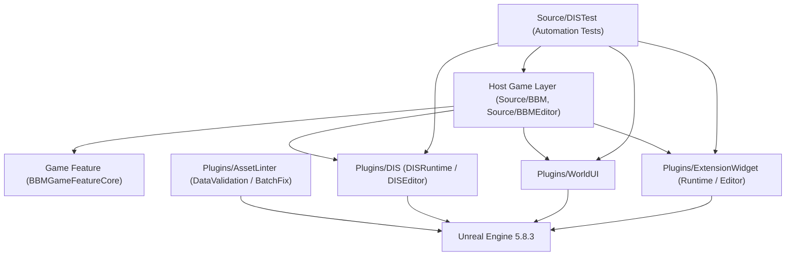

# P_DIS — Data-Driven Inventory System & 배낭 상인 출몰중!

> **Unreal Engine 5.8.3** · **C++20** · **Win64**

## 1. 프로젝트 및 게임 소개 (Project & Game Overview)

`P_DIS`는 **범용 인벤토리 플러그인 개발**과 이를 검증하는 **샘플 게임 제작**을 두 축으로 구성한 Unreal Engine 5 프로젝트입니다.

- **DIS (`Plugins/DIS`)**: 특정 게임 규칙에 종속되지 않고 재사용할 수 있는 **Data-Driven 기반 2D/1D 공간 인벤토리 프레임워크** (`DISRuntime`, `DISEditor`).
- **배낭 상인 출몰중! (`Source/BBM`, 프로젝트명: 비트 배낭 상인 / Beat Backpack Merchant, BBM)**: `DIS` 코어를 상속·확장해 제작 중인 **리듬 × 그리드 인벤토리 퍼즐 × 턴제 로그라이크** 샘플 게임.

### 핵심 게임플레이 (Core Gameplay)
1. **단기 실시간 판단 (`8-Second Real-time Prep`)**: 매 턴 **8초 카운트다운** 동안 배낭 아이템을 드래그·재배치하여 전투 시퀀스를 즉각 재구성합니다.
2. **점유 칸 수 비례 8비트 타임라인 (`Cell-Count Proportional Beats`)**: 사용할 아이템이 점유한 칸 수만큼 행동 비트를 차지하며, 인벤토리 배치 공간의 특정 순서로 사용할 아이템이 정해집니다.
3. **프리뷰를 토한 실시간 판단 (`Monster Intent Preview`)**: 적의 8비트 행동 예고를 보고 아이템 배치를 바꿔 방패 가드·패링·콤보를 구성합니다.
4. **로그라이크 빌드 성장 (`Roguelike Progression`)**: 전투 보상, 배낭 용량 확장(`ExpandCapacity`), 슬롯 및 아이템 강화를 통해 매 판 고유 빌드를 완성합니다.

## 2. 핵심 아키텍처 (Core Architecture)

재사용 플러그인의 독립성을 보장하기 위해 **단방향 의존 계층(Unidirectional Dependency Hierarchy)**을 엄격히 유지합니다. 범용 플러그인(`DIS`, `WorldUI`, `ExtensionWidget`, `AssetLinter`)은 호스트 게임(`Source/BBM`)이나 게임 피처(`BBMGameFeatureCore`)를 절대 참조하지 않으며, 게임 전용 확장(`UsageRule`, 비트 액션, 캐릭터·UI 구현)은 `Source/BBM` 및 `BBMGameFeatureCore` 계층에서만 상속·확장합니다.

### 모듈 구성
| 계층 | 모듈 / 플러그인 | 핵심 역할 |
| :--- | :--- | :--- |
| **Core Plugin** | `Plugins/DIS` (`DISRuntime`, `DISEditor`) | 2D/1D 공간 인벤토리 모델, `PrimaryDataAsset` 아이템 정의, 슬롯/아이템 강화, 에디터 검증·커스터마이징 |
| **UI Framework** | `Plugins/WorldUI` | `UWorldUISubsystem` 기반 8단 `EWorldWidgetZOrder`(0~7) 레이어 수명주기 및 양방향 애니메이션 전환 |
| **Custom Widgets** | `Plugins/ExtensionWidget` | `URichScrollBar`, `URichSlider`, `URichComboBoxKey`, `URichInputKeySelector`, `URichListView` 등 Slate/UMG 확장 |
| **Asset Quality** | `Plugins/AssetLinter` | `DataValidation` + `UDeveloperSettings` 기반 에셋 네이밍/경로 검증 및 `SAssetLinterBatchFixDialog` 일괄 수정 |
| **Game Feature** | `Plugins/GameFeatures/BBMGameFeatureCore` | 게임 코어 데이터 에셋(`Item`, `Combat`, `Stage`, `Input`), WBP 위젯, 독립 로컬라이제이션 타깃 |
| **Host Runtime** | `Source/BBM` | 배낭 확장(`UBBMInventoryComponent`), 다형성 비트 액션, 1D 전투 시뮬레이터, GAS 스탯, 스테이지, 세이브, MVVM ViewModel |
| **Host Editor** | `Source/BBMEditor` | `FBBMBeatSequence` 4단 타임라인 시각화, `UBBMInventoryDefinition` 배낭 프리뷰, 일괄 리네임 유틸리티 |
| **Automated Test** | `Source/DISTest` | `DIS` 코어·`BBM` 게임플레이·`WorldUI`/`ExtensionWidget` 검증용 `AutomationTest` 15개 테스트 모듈 격리 |

## 3. 사용 기술 및 주요 시스템 (Tech Stack & Key Systems)

| 영역 | 적용 기술 및 핵심 구현 |
| :--- | :--- |
| **Engine / Language** | Unreal Engine 5.8.3, C++20, Win64 |
| **Data-Driven Design** | `PrimaryDataAsset` & `AssetBundles`(`UI`·`World`·`Data` 비동기 번들), `FDISItemTypeProfile::bOverrideCustomData` 선택적 상속, `TInstancedStruct` 기반 다형성 `FBBMBeatAction` · `FBBMRuntimeEncounterData` |
| **Combat & GAS** | `GameplayAbilities` (`UBBMAttributeSet`, `GameplayEffect`, `SetByCaller`), `CompositeCurveTable` + `FAttributeSetInitterDiscreteLevels` 레벨별 스탯 주입, `UBBMCombatManagerSubsystem` 10단계 턴 시뮬레이션 및 4단계 피해 해결 |
| **UI & MVVM** | `ModelViewViewModel` (`FieldNotify` 선대입 양방향 바인딩), `UWorldLayerRootWidget` 레이어 라우팅, Slate `SBorder`/`SPanel` 커스텀 위젯 및 `ExtensionWidgetEditor` 디테일 확장 |
| **Input & Save** | `EnhancedInput` (`RuntimeIMC` 복제, 런타임 키 리매핑 `RemapByName`, Chord Modifier), `UBBMRunSaveGame` · `UBBMUserSaveGame` 비동기 저장/복원 |
| **Localization & QA** | 호스트(`Game`) 및 플러그인(`DIS`, `DISEditor`, `AssetLinter`, `BBMGameFeatureCore`) 독립 `LocalizationTargets`, `UEditorValidatorBase` 기반 `AssetLinter`, `Misc/AutomationTest.h` 기반 `DISTest` |

## 4. AI 기반 개발 워크플로우 (AI-Assisted Development Workflow)

멀티도메인(C++ · 기획 · 디자인 · 3D/UI 에셋) 개발 과정에서 아키텍처 오염과 컨텍스트 비대화를 방지하기 위해, 도메인별 문서(`Docs/`)를 `8KB` 단위로 분할·동기화하는 SSOT 체계와 `Gate 1`(제3자 리뷰어 기반 DRY·성능·안전성·모듈 역참조 감사) 통과 후 `Gate 2`(`DISTest` 단위 테스트)로 진입하는 순차 검증 파이프라인을 운영합니다. 자체 제작 `AssetLinter` 자동 검증을 결합해 생산성과 코드·에셋 일관성을 함께 유지합니다.

